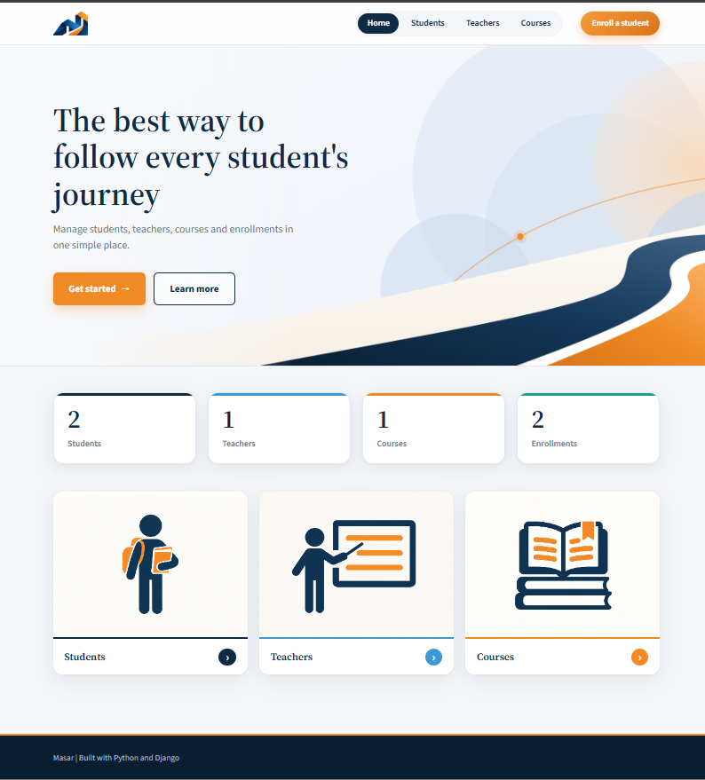
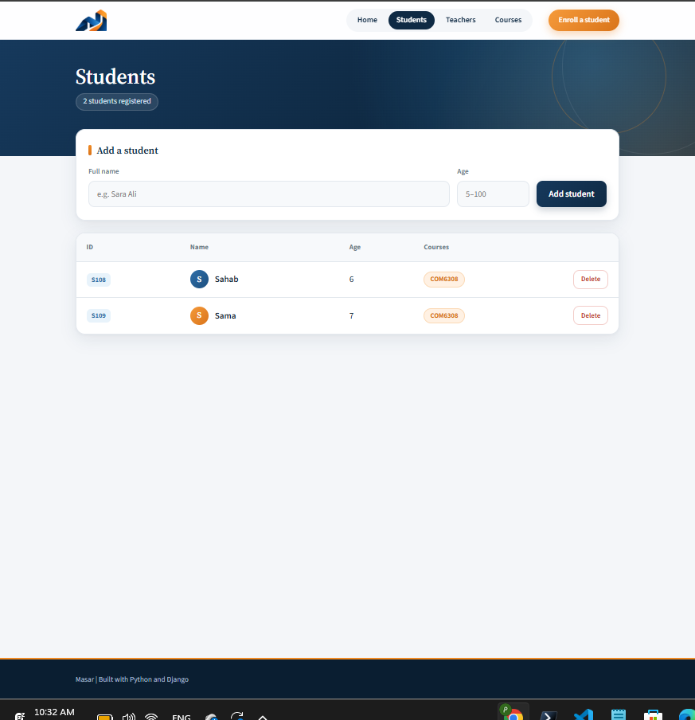
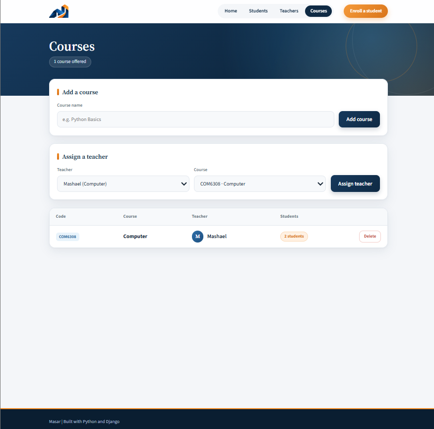
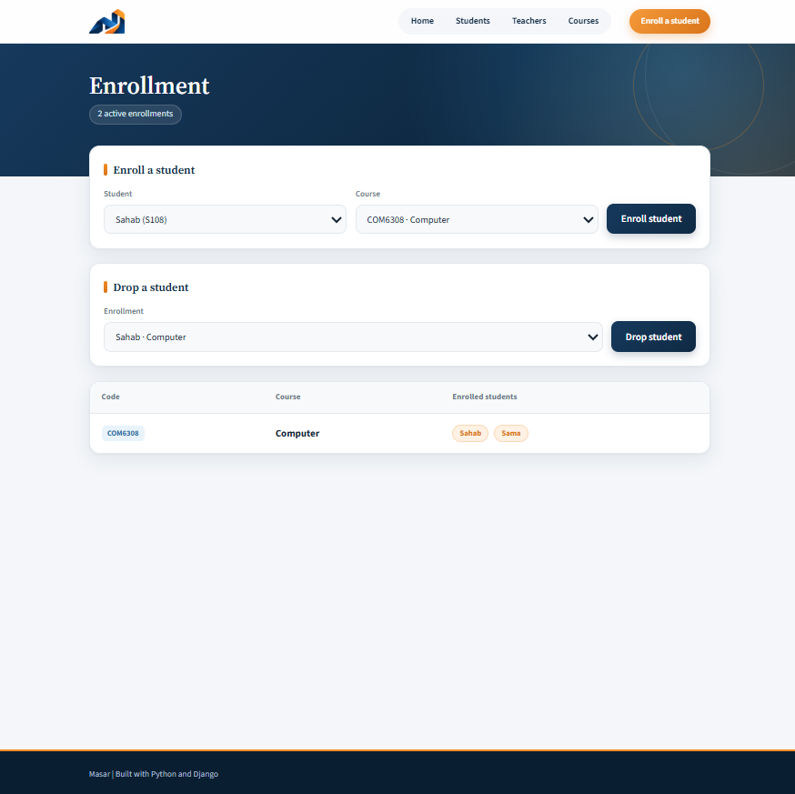
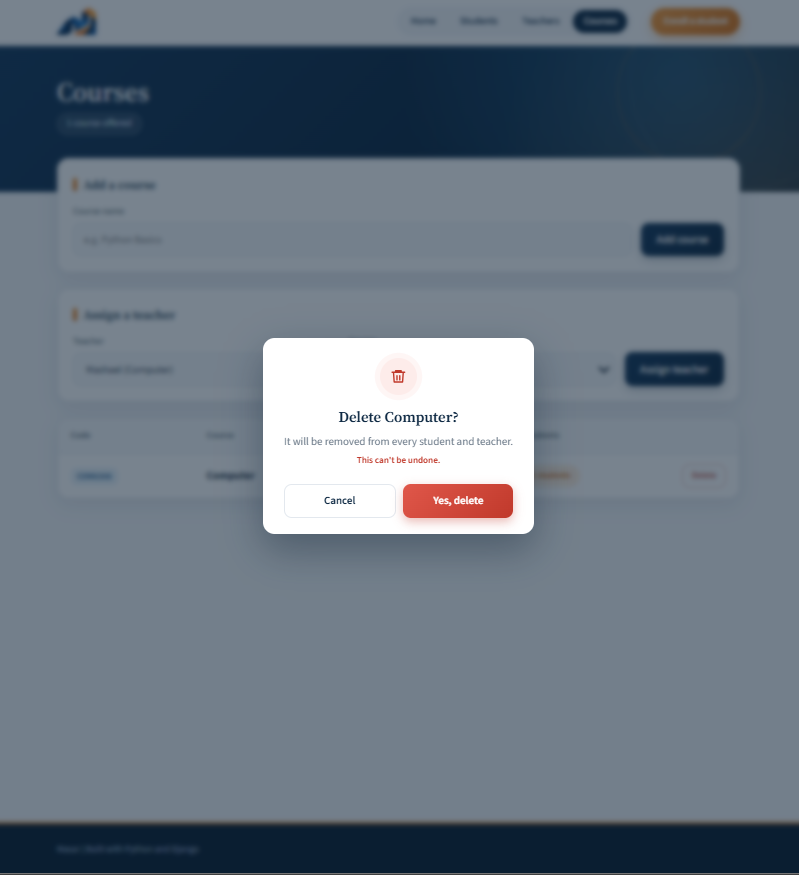
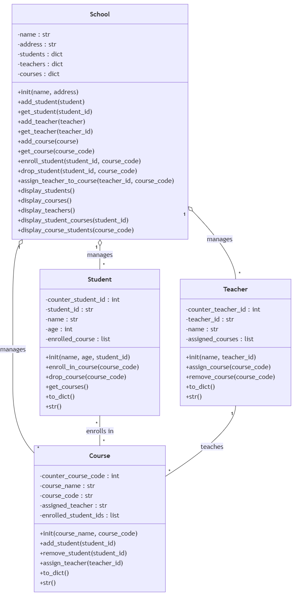
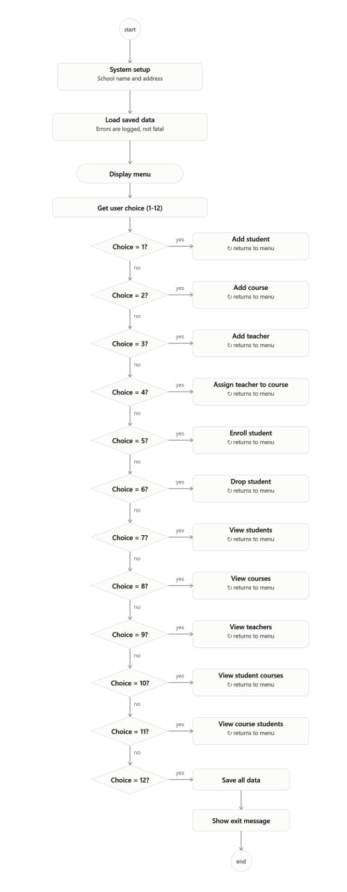

<p align="center">
  
</p>

<h1 align="center">Masar · مَسار</h1>

<p align="center">
  <b>The best way to follow every student's journey.</b><br>
  A school management web app built with Python OOP and Django.
</p>

<p align="center">
  
  
  
</p>

---



##  About

Masar started as my **Unit 2 project at Tuwaiq Academy**: a console app for managing a school's students, teachers and courses, built with **Object-Oriented Programming** and saved to **JSON files**.

I then built a **Django web interface on top of the same classes**. The web app doesn't use Django models or a database. Every page calls the same `School` object the console app uses, and every change is saved back to the same JSON files. The two interfaces share one core.

---

##  Features

- **Students:** add a student (the ID like `S100` is generated automatically), see their courses, delete them.
- **Teachers:** add a teacher with a subject, see the courses they teach, delete them.
- **Courses:** add a course (the code like `PYT300` is generated from its name), assign a teacher, delete it.
- **Enrollment:** enroll a student in a course or drop them, and see who is in every course.
- **Dashboard:** live counts of students, teachers, courses and enrollments.
- **Safe deletes:** a custom confirmation window explains what will happen before anything is removed. Deleting cleans up every link, for example deleting a course removes it from each student and from its teacher.
- **Clear feedback:** every action shows a success or error message.
- **Validation and duplicate protection:** no empty names, no duplicate records, no enrolling a student twice.
- **Responsive design:** works on desktop and mobile.

---

##  Screenshots

| Students | Courses |
|---|---|
|  |  |

| Enrollment | Delete confirmation |
|---|---|
|  |  |

---

##  How It Works

```
Browser ──▶ Django views ──▶ School object (OOP) ──▶ JSON files
                ▲                                       │
                └────────────── templates ◀─────────────┘
```

| Layer | Where | Job |
|---|---|---|
| Models (OOP) | `models/` | `Student`, `Teacher`, `Course` and `School` classes with all the business rules |
| Utilities | `utils/` | Reading and writing JSON, validating input, logging errors |
| Web service | `portal/school_service.py` | Loads one shared `School` object from JSON when the server starts |
| Views | `portal/views.py` | Handle each page and form, call `School`, then save to JSON |
| Templates and styles | `portal/templates/`, `portal/static/` | The pages, the design and the delete window |
| Console app | `main.py` | The original text-menu version, still working |

### The four classes

| Class | Stores | Main responsibility |
|---|---|---|
| `Student` | ID, name, age, enrolled course codes | Enroll in and drop courses |
| `Teacher` | ID, name, subject, assigned course codes | Track which courses they teach |
| `Course` | Code, name, assigned teacher, enrolled student IDs | Track its teacher and students |
| `School` | Dictionaries of students, teachers and courses | Connects everything: enrolling, assigning, deleting, reporting |

`School` keeps both sides of every relationship in sync. Enrolling a student adds the course to the student **and** the student to the course. Deleting reverses every link.

### Design decisions

- **Reused the OOP core instead of rewriting it as Django models.** The goal was to show that well-designed classes can power more than one interface.
- **POST, then redirect** after every form, so refreshing the page never repeats an action.
- **Deletes only accept POST** with a CSRF token, so a link can never delete data by accident.

### Diagrams

Planned before coding, using UML.

**Class diagram**



**Use case diagram**


**Activity diagram**



---

##  Project Structure

```
school_system/
├── manage.py
├── main.py                     # Console version
├── config/                     # Django settings and root URLs
├── portal/                     # The web app
│   ├── school_service.py       # One shared School object, loaded from JSON
│   ├── views.py
│   ├── urls.py
│   ├── templates/portal/       # base, home, students, teachers, courses, enrollment
│   └── static/portal/          # style.css and images
├── models/                     # student.py, teacher.py, course.py, school.py
├── utils/                      # file_handler.py, validators.py, logging.py
├── data/                       # students.json, teachers.json, courses.json
├── diagrams/                   # UML class, use case and activity diagrams
└── docs/                       # Logo and screenshots for this README
```

---

##  Run It Locally

**Requirements:** Python 3.10 or newer.

```bash
git clone https://github.com/Mashael16/school_system.git
cd school_system

python -m venv venv
venv\Scripts\activate          # macOS / Linux: source venv/bin/activate

pip install django
python manage.py migrate
python manage.py runserver
```

Then open **http://127.0.0.1:8000** in your browser.

To use the original console version instead:

```bash
python main.py
```

---

##  What I Learned

- Designing classes and the relationships between them (OOP)
- Keeping two-way relationships consistent, including when deleting
- Saving and loading objects with JSON
- Connecting existing Python code to Django views, URLs and templates
- Handling forms safely with POST, CSRF tokens and redirects
- Using Django's messages framework for user feedback
- Building a consistent design with CSS variables
- Planning with UML diagrams before writing code

---

##  Future Improvements

- Attendance tracking and grades for each course
- Edit existing students, teachers and courses
- Search and filters on every list
- Login with roles for admins and teachers
- Move from JSON files to a database when the school grows

---

## 👩‍💻 Author

**Mashael** · Tuwaiq Academy, Python & Django Bootcamp
[GitHub](https://github.com/Mashael16) · [LinkedIn](https://www.linkedin.com/in/your-profile)